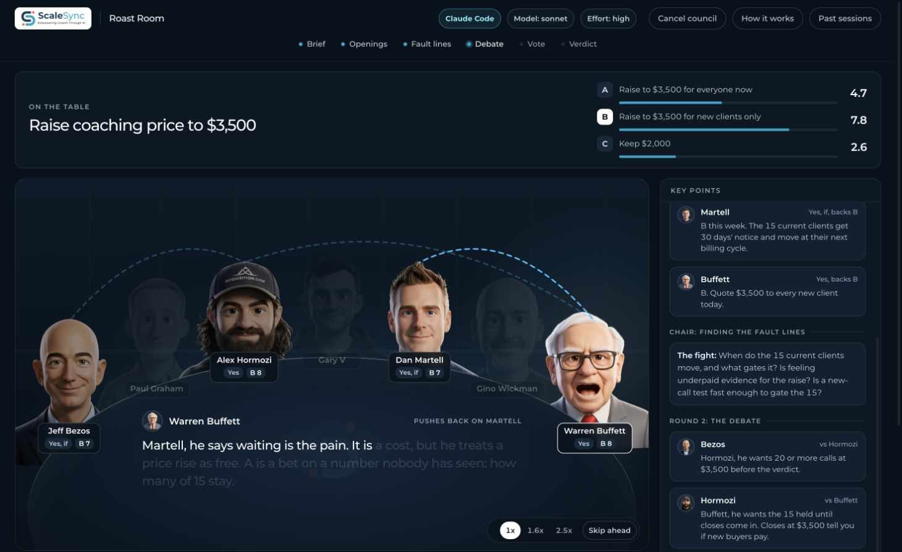

# Roast Room · ScaleSync edition




Put a business decision to a simulated council, watch its discussion in a local browser room, and save the verdict as a PDF. This is a ScaleSync edition of [nateherkai/roast-room](https://github.com/nateherkai/roast-room). The original advisor material, example sessions, and MIT license remain. The advisor voices are simulations based on public work; the people shown are not affiliated with this project and do not endorse its answers.

**Live URL after starting:** [http://localhost:4730](http://localhost:4730). This is a local app on your computer. GitHub distributes its code; GitHub Pages cannot run its Node server or your signed-in Claude/Codex CLI. Keep the computer and local runner available while a council is working.

## Start in one command

You need Git, Node.js 20 or newer, and **one** signed-in local CLI:

- [Claude Code](https://code.claude.com/docs/en/quickstart): install it and run `claude auth login`.
- [Codex CLI](https://developers.openai.com/codex/cli): install it and run `codex login`.

```bash
git clone https://github.com/Anand195/scalesync-roast-room.git
cd scalesync-roast-room
npm run launch -- --runner auto
```

`auto` prefers signed-in Claude Code, then Codex CLI. To choose explicitly, use `--runner claude` or `--runner codex`. The launcher checks authentication, saves the choice in a git-ignored `.env`, starts the server, checks readiness, opens the browser, and prints the URL. It installs no npm dependencies. Add `--no-open` to keep the browser closed.

For a foreground server, put `COUNCIL_RUNNER=claude` or `COUNCIL_RUNNER=codex` in `.env`, then run `npm start`. The original default `viewer` mode still plays councils started by the `/roast-room` Claude Code skill. Optional `api` mode uses `ANTHROPIC_API_KEY`; see `.env.example`.

### Give this prompt to Claude Code or Codex

Copy the whole block into a terminal Claude Code or Codex chat. The assistant should finish setup and give you the usable URL:

```text
Set up and launch the ScaleSync edition of Roast Room from
https://github.com/Anand195/scalesync-roast-room.

Goal: I can type a new business decision into the local Roast Room webpage,
have it processed by my signed-in Claude Code or Codex CLI in the background,
choose that provider's model and effort, attach PDF/Markdown/text/images,
cancel a run if needed, continue a completed thread, and get a concrete
action plan and copy-paste build prompt with the verdict.

1. Check that Git and Node.js 20+ are installed. Check `claude auth status`
   and `codex login status`. Use signed-in Claude Code if available;
   otherwise use signed-in Codex CLI. If neither is signed in, guide me
   through the appropriate CLI login, then continue. Never request or print
   an API token.
2. Clone the repository into a sensible folder, or use an existing clone.
   Do not overwrite user files. Read its README before running anything.
   Keep `.env` and `sessions/` out of Git.
3. From the repository root, run `npm run launch -- --runner auto` (or pass
   the selected runner explicitly). If port 4730 is occupied, identify the
   process and repository first; stop only a stale Roast Room instance that
   is safe to replace. Do not kill unrelated services.
4. Verify `http://localhost:4730/api/health` reports this repository and
   the chosen runner. Verify the homepage loads. Open
   `http://localhost:4730` in my browser.
5. Verify the page badge identifies Claude Code or Codex CLI. Verify Model
   and Effort selectors show that runner's choices. Confirm the Start council
   button is visible in the sticky header even on a short desktop window.
   Tell me the exact live
   local URL and runner. Explain that I enter the decision, options, numbers,
   constraints, deadline, and lean; choose model, effort, Quick, Full, or Ultra;
   click “Start council” or “Convene the council”; then watch the result.
   Explain that PDF, Markdown, text, CSV, JSON, and image files may be dropped
   into the question area, but audio and video are rejected. Explain that
   the live header shows the chosen provider, model, and effort; Cancel council
   stops the running CLI while keeping the question in Past sessions.
   After the verdict, explain how to open the action plan, copy the build
   prompt, continue the same thread, or start a new one.
6. If anything fails, read `sessions/room-server.log` and the relevant
   `sessions/<id>/runner.log`, fix the actual issue, retry, and report what
   you verified. Do not claim a council was tested unless one completed.

This is a local web application. Report `localhost` as the live URL; do not
claim it is a public hosted service or expose it to the internet.
```

## Ask a question in the browser

1. Open [http://localhost:4730](http://localhost:4730). The badge identifies the active provider. The provider is selected when the server starts; use `npm run launch -- --runner claude` or `--runner codex` to choose another one after stopping the current server.
2. Write one decision: options, business context, revenue/cash/team if relevant, constraints, success target, deadline, and your current lean. Missing facts are marked as assumptions because the background council cannot pause to ask you.
3. Drop or choose up to five files, 10 MB each and 20 MB total. Supported: PDF, Markdown, plain text, CSV, JSON, PNG, JPEG, WebP, GIF. Audio and video are rejected. Files stay under the git-ignored `sessions/<id>/attachments/`. The local CLI reads them as evidence. If it cannot read a PDF, its report must say so; inspect that warning before relying on the verdict.
4. Choose **Model** and **Effort**, or leave either at **CLI default**. Claude Code offers model aliases. Codex reads its local model cache to list visible models and supported efforts; before that cache exists, the room offers built-in suggestions. Availability depends on your CLI login and plan. While a run is active, the sticky header shows the provider and saved model/effort. **CLI default (not pinned)** means the CLI resolves the value; the room does not claim an exact model in that case.
5. Choose **Quick** (four advisors, usually two rounds), **Full** (about five to seven advisors, three rounds), or **Ultra** (exactly nine advisors, five rounds) and click **Start council** in the header or **Convene the council** below the form. Ultra adds a stress test and final vote. Its warning appears beside the start action: 45 advisor turns plus Chair work can use substantially more tokens and take much longer. One local CLI council runs at a time.
6. Read the verdict and its **Execution roadmap and build prompt**. The saved `action-plan.md` includes feature behavior and acceptance checks for product decisions, phased milestones, gates, open questions, and a fenced prompt you can copy into a new Claude Code or Codex session. **Download PDF** includes the action plan. The plan is generated advice: verify important assumptions before building.
7. To explore the same decision, write a follow-up under **Conversation** and click **Continue this thread**. The next council receives the previous verdict and action plan; each turn is saved separately and linked by `threadId`, `parentId`, and `turn` in `request.json`. **Start a new thread** resets the room for an unrelated decision. **Cancel council** stops the active local process. **Past sessions** replays completed turns. All session files are local and ignored by Git.

Example question:

> I run a coaching business at $30k a month with 15 clients at $2,000 each. Should I raise to $3,500 for everyone, raise only for new clients, or keep $2,000? Close rate is about 50%, I have $40k in cash, and success means $45k monthly by March. I lean toward raising for everyone. Please test that view.

## Use it from desktop AI chats

The dependency-free local MCP server `app/mcp.mjs` exposes `roast_room_start`, `roast_room_continue`, `roast_room_cancel`, `roast_room_wait`, `roast_room_status`, `roast_room_history`, and `roast_room_result`. A desktop chat can submit a question with optional model and effort, continue a completed turn, cancel its session, and read the verdict and action plan. Configure its stdio command as your Node executable followed by the absolute path to `app/mcp.mjs`. Keep the repository's `.env` set to `COUNCIL_RUNNER=claude` or `codex`. The MCP server starts the room if it is stopped.

For Codex CLI/Desktop:

```bash
codex mcp add roast-room -- node /absolute/path/to/scalesync-roast-room/app/mcp.mjs
```

For Claude Desktop, add a `roast-room` entry under `mcpServers` in `claude_desktop_config.json` (on macOS, `~/Library/Application Support/Claude/claude_desktop_config.json`):

```json
{
  "mcpServers": {
    "roast-room": {
      "command": "/absolute/path/to/node",
      "args": ["/absolute/path/to/scalesync-roast-room/app/mcp.mjs"]
    }
  }
}
```

Merge that entry into any existing configuration rather than replacing other servers. Restart the desktop app to load the tools. MCP configuration is optional for browser use.

## Compatibility with the original project

This repository retains the original `.claude/skills/roast-room/` and `.claude/agents/` structure, `npm start`, viewer mode, API mode, sample sessions, advisor brains, quote checker, PDF generation, and `/newroaster` skill.

| ScaleSync addition over Nate Herk's original | Practical use |
|---|---|
| Browser question entry and sticky Start council button | Ask without switching to a terminal, even in a short desktop window. |
| Claude Code or Codex local runner, model and effort selectors, live badges | Use a signed-in provider, see the settings saved for the active run, and avoid mistaking a CLI default for a pinned model. |
| Cancellation and saved request/history | Stop a local CLI council and recover the question, status, and completed verdicts. |
| Document and image attachments | Bring a PDF, brief, notes, data, or screenshots into the same council. |
| Linked follow-up turns | Ask for more detail while carrying forward the prior verdict and action plan. |
| Ultra council and responsive advisor grid | Seat nine relevant advisors for five rounds with a visible token warning; keep every advisor and start control legible on phone, tablet, and desktop. |
| Action plan and full PDF export | Get feature functionality, validation gates, a roadmap, and a development prompt you can paste into a new coding session. |
| Desktop MCP connector and one-command launcher | Start and query the same local room from Claude Desktop, Codex Desktop, or a browser. |
| ScaleSync branding and upstream review | Keep the original advisor material while tracking upstream updates for deliberate merges. |

The Git remote named `upstream` points to [nateherkai/roast-room](https://github.com/nateherkai/roast-room). Upstream changes should be reviewed and merged deliberately; do not overwrite ScaleSync branding or local runner changes. A recurring 15-day check reports new upstream commits and compatibility risks. It does not silently merge unreviewed code. See [docs/UPSTREAM.md](docs/UPSTREAM.md) for the local commands and review checklist.

## Troubleshooting and verification

| Symptom | Check |
|---|---|
| Login check fails | Run `claude auth status` or `codex login status` in your own terminal. Sign in with `claude auth login` or `codex login`. |
| Port 4730 is occupied | Run `curl http://localhost:4730/api/health`; stop the old instance only after identifying it. |
| Page starts but council does not | Open Past sessions, then check `sessions/<id>/request.json` and `runner.log`. The question remains saved even if the run fails. |
| Selected model or effort is rejected | Try **CLI default**, confirm the model is available to your account, and update the relevant CLI. Codex choices come from its local model cache when present. |
| Room not ready | Read `sessions/room-server.log`; verify Node 20+ and the selected `COUNCIL_RUNNER`. |
| Desktop tools absent | Check the MCP command's absolute paths and restart Claude Desktop or Codex Desktop. |

Run `npm run check` for offline structure and syntax checks. The upstream `npm run smoke` command makes a live Anthropic API call and requires an API key; use it only when testing `api` mode. For a real end-to-end check, submit a small **Quick** decision, wait for `verdict.json`, open it from Past sessions, and run:

```bash
python3 .claude/skills/roast-room/scripts/check_quotes.py sessions/<id>
```

### Verify on another computer

1. Clone the released repository, sign in to Claude Code or Codex CLI, and run `npm run check` followed by `npm run launch -- --runner auto`.
2. Open the printed local URL in a short desktop window and a phone-sized window. Confirm **Start council** is visible in the sticky header, the form and file picker remain scrollable, and no content causes horizontal overflow.
3. Submit a **Quick** sample decision with a small Markdown or PDF attachment. During the run, confirm the provider, model, and effort badges match the selections and that **Cancel council** is available. Let this run finish.
4. Verify `sessions/<id>/request.json`, the attachment copy, `verdict.md`, `action-plan.md`, and `verdict.json`. Read the action plan in the browser, copy its fenced build prompt, and download the PDF to confirm it contains the roadmap.
5. Ask a follow-up under **Conversation** and verify the next request has the same `threadId`, its predecessor as `parentId`, and an incremented `turn`. Use **Start a new thread** and verify the fresh question begins at turn 1.

The PDF/image reader available to a CLI can vary by provider and operating system. If a file cannot be read, the council should state that limitation; do not rely on content it could not inspect. Sessions and attachments are local and excluded from Git.

A successful smoke check cannot guarantee future behavior of upstream updates, CLI authentication, model availability, or a user's local environment.

## Attribution and licenses

Original Roast Room by AI Automation Society: [nateherkai/roast-room](https://github.com/nateherkai/roast-room). Its MIT license and copyright notice remain in [LICENSE](LICENSE). The PDF builder bundles jsPDF (MIT) and Montserrat (SIL Open Font License); their license files remain beside the bundled assets. ScaleSync logo and icon were supplied for this edition. Advisor quotations are short source-attributed excerpts for commentary and education. The simulated advisors do not speak for the real people.
